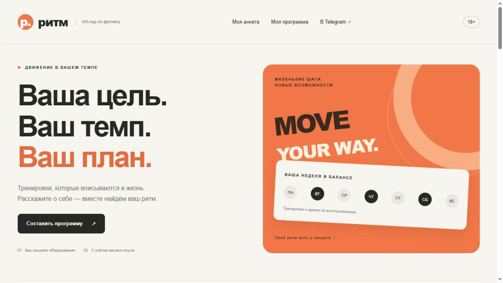
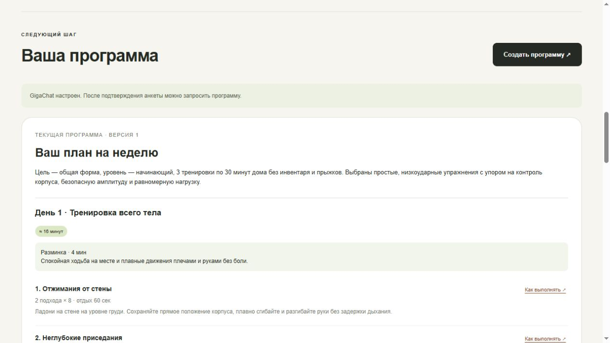
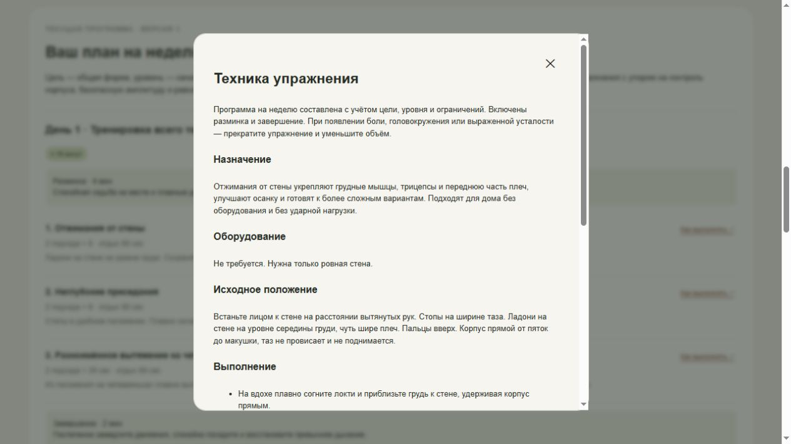
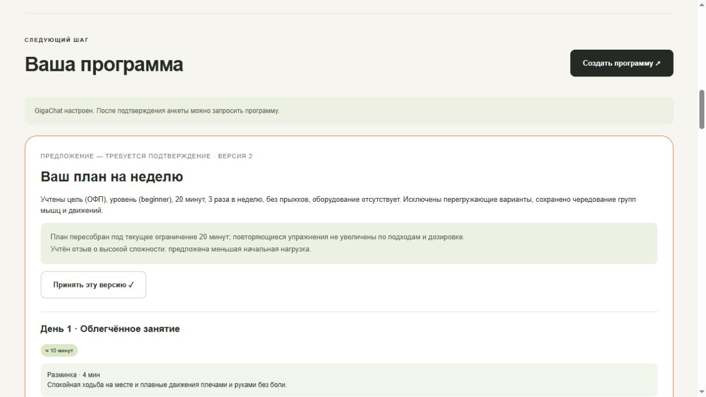

# Коммерческое предложение: «Ритм»

ИИ-гид по фитнес-программам. Учебный прототип, 19 октября 2026 года.

## Предложение

Предлагается прототип цифрового помощника для фитнес-проекта: сайт и Telegram-бот с общей логикой подбора тренировок. Он помогает взрослому пользователю перейти от общих пожеланий к понятному недельному плану и скорректировать его по обратной связи.

Потенциальный заказчик — тренер, небольшая фитнес-студия или онлайн-проект, которому нужен первый цифровой контакт с клиентом. Это предполагаемая область применения, а не подтверждённый коммерческий заказ.

## Возможности и результат

- Анкета: цель, опыт, частота, время, место, оборудование, предпочтения и ограничения.
- Недельная программа: занятия, разминка, упражнения, подходы, повторения, отдых и оценка времени.
- Объяснение выбранного упражнения: положение, последовательность, дыхание, ошибки и упрощение.
- Обратная связь и адаптация с отдельным подтверждением новой версии.
- История программ; два интерфейса используют общий сервис, но отдельные профили.

Пример: учебный пользователь, 28 лет, начинающий, дома без инвентаря и прыжков, три занятия до 30 минут в неделю. Полученные занятия занимают около 16 минут. Тридцать минут — верхний предел, а не фактическая продолжительность.

GigaChat выбирает упражнения из допустимой части каталога и объясняет их. Сервер проверяет ответ, формирует дозировку и расписание. При ошибке структуры допускается один запрос исправления. Ошибка API не подменяется якобы сгенерированной программой.

После учебного отзыва о сложности 7/10 и изменения доступного времени до 20 минут предложены занятия около 10 минут. Предложение требует подтверждения; действующая версия сохраняется до принятия новой.

Все четыре скриншота сняты с действующего интерфейса, загруженного сохранёнными результатами реального API-теста. Анкета вымышленная; это не новый запрос к модели и не доказательство реально выполненной тренировки.

## Качество и границы первой версии

28 автоматических тестов пройдены, включая матрицу 168 сочетаний длительности, частоты и уровня. На одной синтетической анкете успешны 5/5 созданий и 5/5 адаптаций через настоящий GigaChat API. Это небольшая серия, которая не доказывает качество для любых условий.

Каталог содержит 12 упражнений. Нужны дополнительные проверки обработки боли, исторических отзывов и переноса упражнений между днями. Проверки формата и времени не заменяют экспертную оценку программы. Прототип предназначен для взрослых; рекомендации носят информационный характер.

## Техническая основа и передача

Python, Flask, python-telegram-bot, Pydantic, SQLite, HTML/CSS/JavaScript, GigaChat API. Ключ хранится локально в .env; временный токен обновляет сервер. Секреты, базы и журналы исключены из материалов сдачи.

Передаются исходники, пример настроек без ключей, инструкции запуска, промпты, тесты, отчёт, сценарий демонстрации и коммерческое предложение. Сайт работает локально, бот отвечает при запущенном процессе. Публичный хостинг и единый аккаунт двух каналов пока не реализованы.

Следующий этап: расширение каталога и приёмочных сценариев, экспертная проверка, привязка профилей, затем размещение на сервере. Стоимость, сроки внедрения, расходы на API и сопровождение определяются отдельно после согласования объёма; в учебном проекте коммерческие обязательства не устанавливаются.

## Ссылки

- [Материалы сдачи](https://github.com/mariannaF-lab/fitness-ai-assistant/tree/implement-fitness-assistant/submission)
- [Исходный код и инструкция запуска](https://github.com/mariannaF-lab/fitness-ai-assistant/tree/implement-fitness-assistant)
- [Telegram-бот](https://t.me/ritm_fitness_bot)

PDF-версия: [COMMERCIAL-PROPOSAL.pdf](COMMERCIAL-PROPOSAL.pdf).
