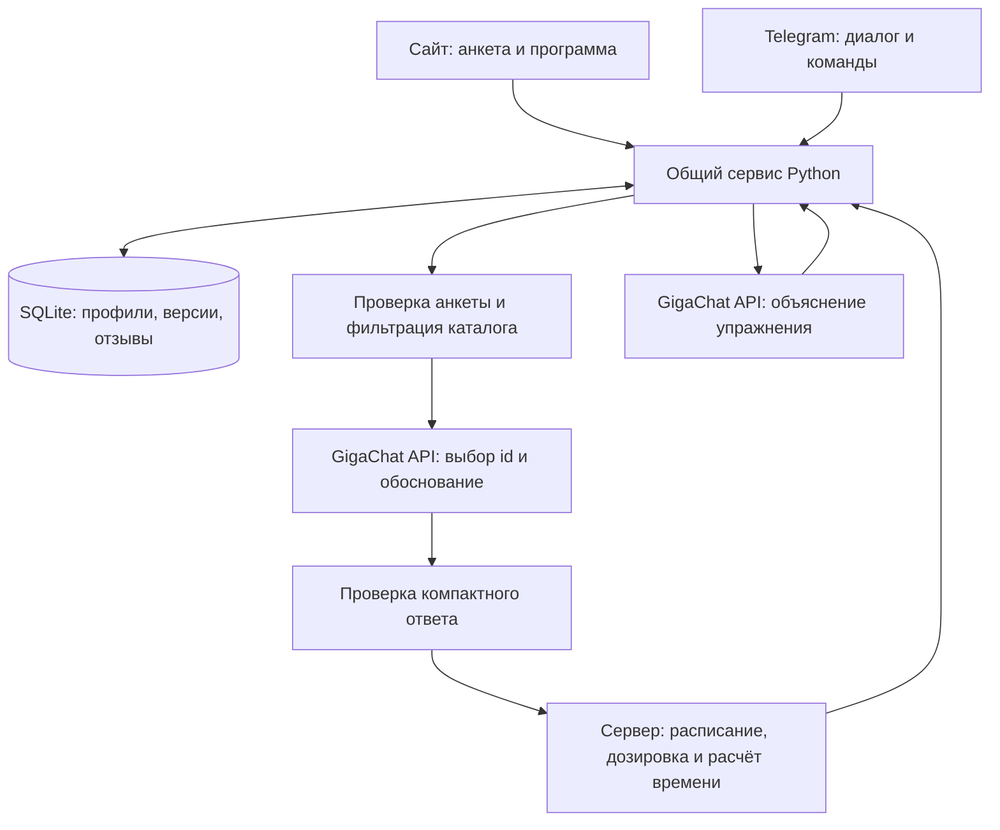

# «Ритм» — ИИ-гид по фитнес-программам

Учебный проект курса по промпт-инжинирингу. Состояние на 19 октября 2026 года.

## Цель и решаемая задача

Создать ИИ-ассистента, который помогает взрослому пользователю подобрать
недельную программу тренировок по цели, опыту, доступному времени, месту,
оборудованию и сообщённым ограничениям. Ассистент объясняет упражнения и
предлагает изменения по обратной связи.

Пользователь взаимодействует с сайтом «Ритм» или Telegram-ботом. Рекомендации
носят информационный характер и не заменяют индивидуальную работу с тренером
или врачом. Первая версия предназначена для пользователей от 18 лет.

## Соответствие заданию

| Требование | Реализация и демонстрация |
|---|---|
| Сбор целей и уровня подготовки | Пошаговая веб-анкета и диалог бота |
| Персональная программа | GigaChat выбирает упражнения по профилю; сервер собирает недельный план |
| Упражнения, подходы, повторения, частота | Карточки занятий содержат дозировку, отдых и дни недели |
| Объяснение техники | Запрос к модели по выбранному упражнению, структурированный ответ и кэш |
| Адаптация | Обновлённая анкета и отзыв → предложение → подтверждение новой версии |
| LLM через API | GigaChat API, модель GigaChat-3-Ultra в проверенном аккаунте |
| Набор промптов | Отдельная инструкция подбора, контекст адаптации, инструкция объяснения и исправление структуры |
| Python и работа с данными | Общий сервис, Pydantic, SQLite, Flask и python-telegram-bot |
| Проверки и демонстрация | Автотесты, серия реальных API-сценариев, сценарий показа и сохранённый пример |

## Архитектура

Стек: Python 3.10+, Flask, python-telegram-bot, Pydantic 2, SQLite, httpx,
HTML/CSS/JavaScript. FastAPI и aiogram обсуждались при проектировании, но
реализованный прототип использует доступные библиотеки без смены общей
архитектуры. MCP-сервер для этой схемы не требуется.

## Данные и взаимодействие

Анкета содержит возраст, цель, опыт, активность, количество и продолжительность
занятий, место, оборудование, ограничения, предпочтения и согласие на передачу
данных модели. Отказ сообщать ограничения хранится отдельно от ответа
«ограничений нет». Имя и контакты не нужны для подбора.

Сайт показывает три шага анкеты и сводку для подтверждения. Бот задаёт вопросы
и сохраняет этап диалога. Оба интерфейса используют общий сервис, но отдельные
профили; автоматическая привязка аккаунтов не реализована.

Каждая программа содержит снимок профиля, номер версии, модель, версию промпта
и статус. Первая готовая программа становится текущей после подтверждения
анкеты. Следующая программа сохраняется как предложение; пользователь принимает
её отдельно, а предыдущая остаётся в истории.

Отзыв фиксирует выполнение, фактическое время, субъективную сложность, ответ
о боли и комментарий. Сохранение отзыва само по себе не меняет нагрузку.

## Промпт-инжиниринг и устойчивость

Исходно LLM формировала большой JSON целой недели. Тесты выявили ошибки
числовых полей, превышение времени и упоминание неуказанного оборудования.

В версии 2.0 задача разделена. GigaChat выбирает id из отфильтрованного каталога
и кратко объясняет выбор. Сервер формирует названия, технику, дозировку,
расписание и оценку времени. Каталог первой версии содержит 12 упражнений.
Упражнения с дополнительным инвентарём доступны только при его наличии.

Таким образом, LLM участвует в персональном подборе и объяснениях, а числовые
ограничения проверяются обычным кодом. Входные данные отделены от системной
инструкции. Неизвестные id не заменяются догадками; допускается один запрос
исправления, после которого некорректный результат завершается ошибкой.

Оценка времени учитывает разминку, завершение, повторения/секунды, отдых,
переходы и запас. Доступные 30 минут — верхний предел, а не требование заполнить
их нагрузкой. В сохранённом примере начальные занятия занимали около 16 минут.
После отзыва о сложности 7/10 и изменения лимита до 20 минут предложены занятия
около 10 минут. Это не демонстрация сокращения «ровно 30 → ровно 20».

## Интеграция и хранение секретов

Исходный Authorization key хранится в локальном .env. Сервер получает и
обновляет временный Access token. Ключи не передаются браузеру и исключены
из архива сдачи. Проверка TLS включена; для рабочего окружения настроены
доверенные сертификаты и отдельные параметры прокси.

Веб-профиль защищён серверной сессией, изменяющие запросы требуют CSRF.
Проверяется принадлежность программы пользователю. Telegram-бот запускается
отдельным процессом; ссылка на него сама по себе процесс не запускает.

## Результаты тестирования

28 автоматических тестов прошли. В них входит матрица 168 сочетаний
длительности, частоты и уровня подготовки, а также проверки анкеты, доступа,
истории, оборудования, ошибок структуры, повторов, кэша и обновления токена.

На одном синтетическом профиле проведены пять повторных полных сценариев
с настоящим GigaChat: 5/5 созданий и 5/5 адаптаций успешны с первого запроса.
Всего выполнено 11 вызовов модели: 10 операций с программами и одно объяснение.
В данной серии создание занимало 1,36–2,38 секунды, адаптация — 1,22–1,36.

Проверены также кэш объяснения, сохранение отзыва, подтверждение и история.
Сообщение о боли в переданной обратной связи блокировало назначение новой
нагрузки при адаптации без нового вызова LLM.

Серия выполнялась через общий HTTP API приложения на изолированной базе;
её нельзя выдавать за видеозапись ручного показа сайта и Telegram. Эти
интерфейсы показываются отдельно по DEMO-SCRIPT.md.

## Ограничения и дальнейшее развитие

- Ограниченный каталог и небольшая серия тестов не покрывают все цели и ограничения.
- Проверка формата и времени не доказывает профессиональную пригодность тренировки.
- Нужны дополнительные сценарии переноса упражнения между днями, свежей генерации после боли и исторических отзывов.
- Публичный хостинг, регистрация и привязка сайта к Telegram не реализованы.
- При выключении локальных процессов сайт и бот недоступны.
- Питание, лечение и медицинская реабилитация не входят в проект.

Проект демонстрирует разработку промптов, интеграцию LLM через API, валидацию
пользовательских данных и объединение двух интерфейсов общей логикой.
